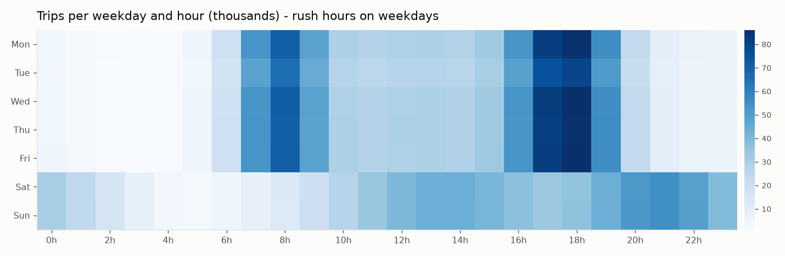
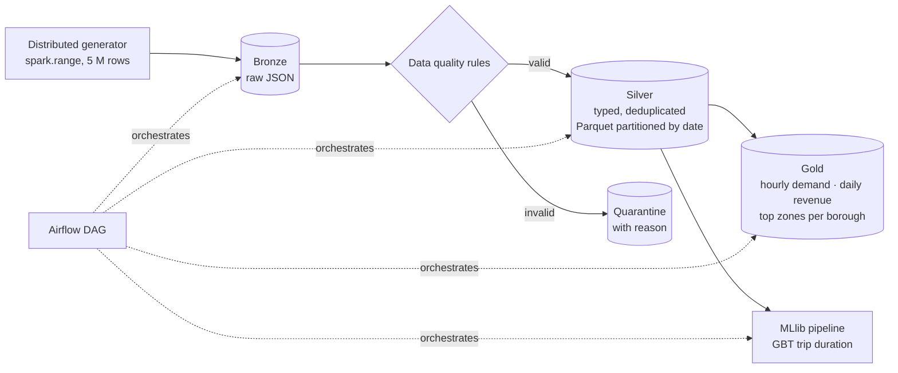
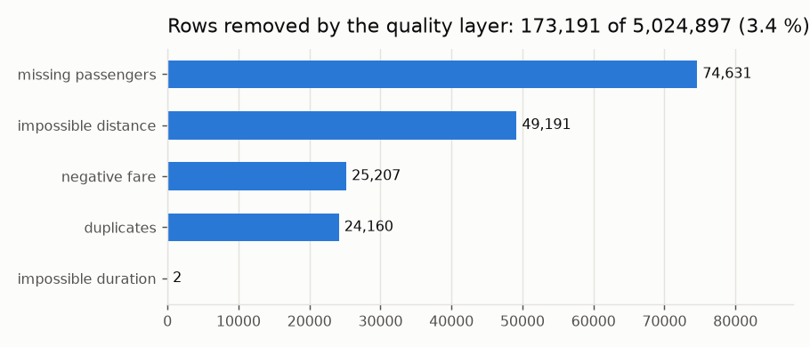
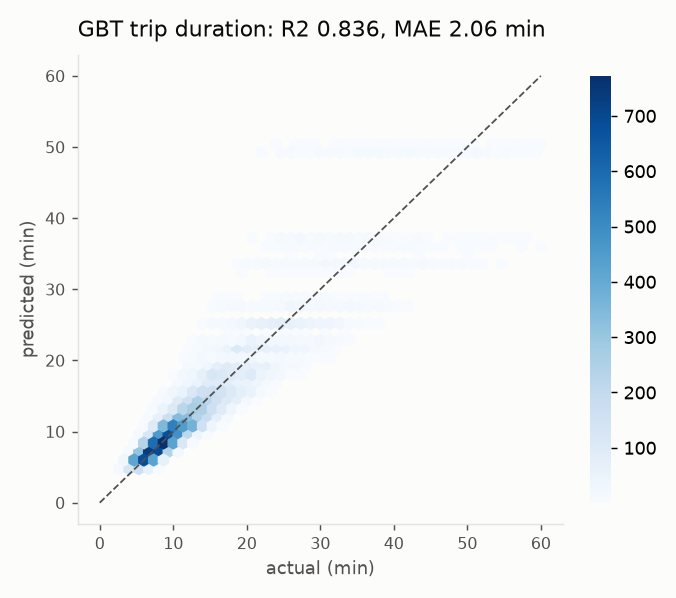
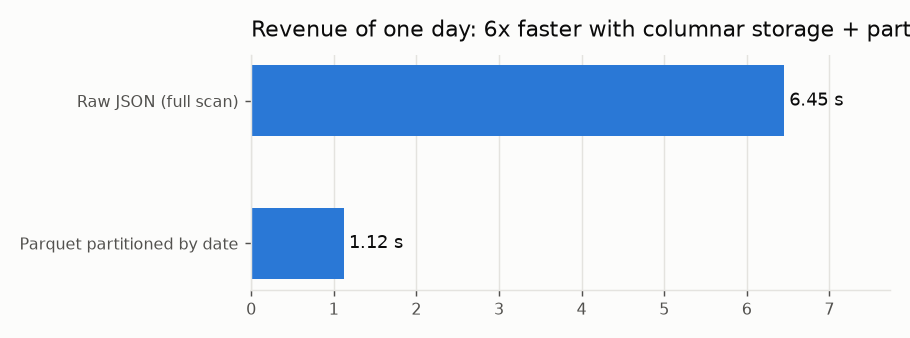

# Big Data lakehouse with PySpark: 5 M taxi trips, bronze → silver → gold → MLlib


A batch data pipeline in the **medallion architecture** that ingests millions of taxi trips,
cleans them with explicit data-quality rules, stores them as **partitioned Parquet**, builds
business aggregates with **Spark SQL and window functions**, trains a **Spark MLlib** model, and
is orchestrated by an **Airflow DAG** on a **Dockerised Spark cluster**.

> 🇫🇷 Pipeline Big Data PySpark (architecture médaillon) : ingestion de 5 millions de trajets,
> contrôle qualité, Parquet partitionné, agrégats Spark SQL, modèle MLlib, DAG Airflow, cluster
> Spark sous Docker et CI.



## Architecture



## Results (5,024,897 raw rows, Spark local mode on 2 CPU cores)

| Stage | What happens | Time |
|---|---|---|
| Bronze | distributed generation and raw JSON landing | 95 s |
| Silver | schema, 4 quality rules, deduplication, date partitioning | 84 s |
| Gold | 3 aggregate tables (broadcast join, window ranking) | 5 s |
| ML | MLlib pipeline (indexer, one-hot, assembler, GBT) on a 20 % sample | 99 s |

<p>
  
  
</p>

- **Data quality**: 173,191 rows removed (3.4 %), each with its reason kept in a quarantine table
  for auditing; 24,160 duplicates removed on the trip id.
- **Trip-duration model** (Spark MLlib GBT): **R² 0.836, MAE 2.06 min**, against 5.83 min for a
  mean-value baseline (777 k training rows, 194 k test rows).



- **Storage layout matters**: the revenue of one day takes 6.45 s on the raw JSON (full scan)
  and 1.12 s on the silver layer, because columnar Parquet reads only the needed columns and
  date partitioning skips the other 89 days.

The data is **synthetic but realistic** (weekday commute peaks, weekend leisure and night
patterns, log-normal distances, rush-hour speeds) and deliberately **dirty** (≈ 1.5 % invalid rows,
0.5 % duplicates), so the same code runs anywhere without downloading a dataset, and scales to
hundreds of millions of rows on a cluster (`--rows`).

## Run it

```bash
pip install -r requirements.txt            # Java 17 required
python -m pipeline.run --rows 5000000      # full run -> lake/ + lake/run_report.json
python -m pipeline.run --steps silver,gold # one or several layers
python scripts/make_figures.py --lake lake # README figures + pruning benchmark
```

On a Spark cluster (1 master + 2 workers, UI on http://localhost:8080):

```bash
docker compose up --build
```

With Airflow: mount the repo and `dags/` in Airflow; the DAG runs
`bronze → silver → [gold, ml]` daily with retries.

## Engineering details

- **Data-quality rules** are declared in one place (`pipeline/silver.py`), applied in priority
  order, and every rejected row keeps the name of the rule it failed.
- **Partitioning** by `pickup_date` for pruning; **adaptive query execution** enabled.
- **Broadcast join** of the small zone dimension, **window function** (`row_number`) for rankings.
- **Tests** (`pytest`, local Spark): quality rules, deduplication, enrichment, determinism of the
  generator, gold tables.
- **CI** (GitHub Actions): lint, tests, an end-to-end run on 500 k rows with the metrics in the job
  summary, and an import test of the Airflow DAG.

## Structure

```
pipeline/  generate.py · silver.py · gold.py · ml.py · run.py · spark.py
dags/      taxi_lakehouse_dag.py (Airflow)
scripts/   make_figures.py (figures + pruning benchmark)
docs/images/  figures and raw numbers (run_report.json, benchmark.json)
```

## Author

**Asma Kerkouri** · DevOps & AI engineer · [LinkedIn](https://www.linkedin.com/in/asma-kerkouri-443b6815a)
